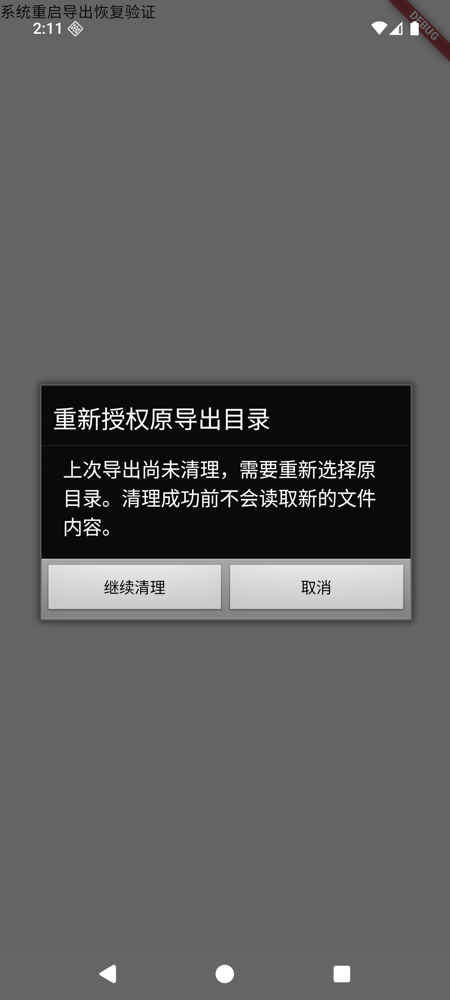

# P5-02 Android 系统重启、原目录重新授权与持久释放收据

2026-10-16；父提交 `d91ec7291a8f7cff9ca54219e8bb59adb1e7dac2`；独立原生客户端工作树，当前变更未提交、未推送。

## 当前结论

**本轮专项通过：API24 Google APIs／API36 AOSP ARM64模拟器、本地受控DocumentsProvider、真实DocumentsUI与实际系统重启。** 用户已批准原目录重新授权及持久释放收据。以前已完成导出后、立即重启导致持久授权回现的实际缺陷，本轮在两个API均再次复现，并验证应用前台启动后重新释放；完成文件保持不变。启动前系统仍可能恢复授权，产品不承诺开机后台自动清理。

[本轮可追溯证据](verification/p5-02-task8-android-release-receipts-results.json)；[此前未通过的历史报告](verification/p5-02-task8-android-system-reboot-results.json)保留原样，不代表修复后的当前结果。

- API24／API36各71项原生检查：旧票据15、目录／重新授权25、Manager销毁交错3、释放收据20、流资源8。测试加载已安装目标APK的真实生产类，使用真实AtomicFile和磁盘；授权／失败／启动代次部分边界受控，不能称为71个真实提供程序故障。
- 同一份269项客户端输入通过共享Flutter242项、静态分析零问题、普通Release构建。真实目标应用UID下可读取BOOT_COUNT；固定Flutter、min24／compile36／target36和锁定依赖不变。
- 五个正式恢复场景共12次实际系统重启；两平台各快速回现复现和后续核销，共另4次，合计16次合格转换。额外API24保留授权分支2次单列，准备失败、宿主中断和不满足快速窗口的诊断不混入。
- 两台设备普通Release安装哈希与构建产物一致，中文登录首屏已目视检查，停止后所属PID不存在。仍为临时Debug测试证书，不是发行签名验收。

## 已实现的规则

原目录恢复只接受与journal完全一致的URI。取消、错目录或结果排队后Activity销毁均保留票据，不读新正文。原有cleanupPending会话在重新取权中销毁后不会擅自自动abort；下一次明确导出请求可以继续恢复。清理旧目标成功后才允许新选择器和新正文。

独立 `no_backup/export-grant-releases.json` 用Android AtomicFile原子持久化版本1元数据：目录URI、本次新增owned权限位、lastReleaseAttemptBoot；无正文。最多32个不同目录，总大小上限98304字节，单URI上限2048 UTF8字节。

1. 在take／部分take／reauthorize前检查容量，新增权限所有权在take前持久记录；仅释放有责任记录的位，保留先前存在的位。
2. 文件清理journal到终态后先转交释放责任，再清journal。同目录收据合并；同一系统启动代次即使release后为零，也不提前丢收据。
3. 每次再次release前先持久更新lastReleaseAttemptBoot。只有更晚的启动代次确认owned位不存在才核销；若回现，再release并等待后代次确认。
4. 应用前台启动及下一次导出前使用同一串行worker核对。启动核对不删除文件，并保护磁盘PREPARED／TREE_PREPARED／ALLOCATING／PENDING所用目录。COMMITTED完成文件不会因收据被删除。
5. 未知启动代次不核销；损坏／未知版本／孤立.new／写入或权限确认失败保留责任，阻断新导出。旧版已清journal且没有owned收据的授权无法自动认定归属，不盲目释放。

## 实际系统恢复矩阵

正式矩阵和快速回现／核销全程使用同一040-final产品APK，SHA256为 `9f096a9e0cff5a4e6c404a05f3fe27542edab5adff522bfabd76307aba2900be`。

| 平台／窗口 | 系统重启数 | 实际断言 |
|---|---:|---|
| API24 创建文件后、票据ACK前 | 3 | 缺失授权；原生提示取消、选择器取消、错目录、同PID真实Activity.recreate；再次从选择器重启；blocked源0，旧目标由应用先删，新文件精确7/11/13，完成后重启保护 |
| API24 RAM ACK40000字节 | 2 | 重启前目标0；阻断源0；原目录恢复、先删旧目标后新建；完成后重启／idle保护 |
| API36 创建文件后、票据ACK前 | 3 | 同上真实取消／错选／销毁及两次恢复边界；首次重启来自050，051独立核验后续作，不重复计数 |
| API36 RAM ACK40000字节 | 2 | 真实冷启动后继续；目标0、阻断源0、恢复及完成文件保护 |
| API36 已落盘4096字节后EIO、持续delete失败 | 2 | 真实ProxyFD故障及PENDING；重启仍阻断；解除所属提供程序门禁后由应用清理，完成后重启保护 |

额外API24保留授权分支：060首次重启后授权仍在，不满足“授权丢失”用例前置条件。061继续验证该分支恢复及完成文件保护，2次重启单列；不算缺失授权界面通过。

### 授权实际回现与收据核销

为确定覆盖原缺陷，独立测试提供程序增加write-open门禁：在真实写入打开前观察OS已持久保存授权3，放行真实FD完成复制，再立即系统重启，release后不等待OS持久化。API24从完成确认到重启命令约6.62秒，API36约2.46秒；**两者重启后、应用启动前均实际回现为3**。

应用启动后凭收据重新释放至0，最近尝试代次更新为当前值；同代次force-stop／idle重启仍保留收据。完成的3字节文件和SHA不变，journal无，源0。随后独立只读观察OS持久存储已无授权，执行另一次真实系统重启并idle，收据核销为entries空，文件不变。这次后续核销的准备等待与快速回现场景分别记录。

测试root仅用于只读检查系统授权存储。API36 ABX通过abx2xml读取输入并写入本轮唯一临时输出，读完删除；不修改系统输入，不注入grant，也不是产品实现依赖。最终独立观察器按精确URI、目标包和所有persisted权限位复核95份原始快照，与原记录零分歧，排除只识别0x3导致漏掉残留读／写权限的问题。

## 证据绑定与复现原则

固定工具链，每台设备独立HOME／ADB／AVD／owner。测试入口为 `integration_test/android_export_reboot_test.dart`，阶段文件仅协调测试；主机不写生产journal、不注入目标URI或系统回调。每次实际adb reboot检查退出0、内核boot_id改变、AVD／ABI／API与安装APK哈希不变、应用在明确启动前未运行；先读磁盘元数据、文件与权限，再启动应用检查源计数和delete-before-create顺序。

040-final的269项输入与共享／分析／Release完全一致。测试后客户端差异限4份README和独立FaultDocumentsProvider.java观察门禁；产品源码与测试APK相同。新提供程序独立构建并与旧提供程序使用同一测试签名，APK和源码哈希另行绑定。普通Release的DEX核查不含测试instrumentation或故障提供程序。

真实AtomicFile／磁盘收据回归先在旧产品目标上观察到RED，再按最小GREEN、扩展检查及最终71项推进。原先生命周期和重新授权的实际RED也保留。此前1643份系统重启原证据、1183份API24原证据及父提交264个客户端blob均独立核验未变。

## 保留的异常与资源清理

- API24初次050系统重启时宿主qemu发生SIGABRT，原进程退出-6，保留匹配PID的macOS诊断；此中断不算产品通过。随后在同一AVD磁盘恢复，独立替代模拟器最终正常退出0，原-6不改写。
- API36首次050观察到boot_completed已为1但用户尚在RUNNING_UNLOCKING，准备失败；后续有界等待解锁并独立续作。060 RAM准备阶段实际出现System UI无响应；062另一次准备缺少应用结果，根因未确定。它们不算合格恢复场景，也不声称整段历史零ANR。
- 081 API24完成后到重启16.73秒，不满足快速窗口；083有旧事件误匹配／ABX误读，观察门禁超时后产品返回export_unavailable并清理未完成文件。保留084现场，不计快速通过。085才是两平台合格回现验证。
- 拆除前归档完成文件、sentinel和提供程序事件；卸载／主机删除属测试拆除，不算产品自动清理。两个运行管理器实际退出0；私有ADB按所属会话终止。独立核实26条进程记录、7端口无监听、临时根／AVD移除、5份夹具密钥删除，真实HOME未产生.android。固定SDK／JDK／镜像／缓存和原始证据保留。

## 验收边界

Task5／6／7／8仍为in_progress，原始BASE不变。本轮未提交、未推送、未合并、未部署、未执行CI；主工作区既有未跟踪设计文档保留。上述通过限本地受控提供程序及两个ARM64模拟器；物理设备、其它ABI／OEM、断电、任意云盘关闭后异步提交、发行签名、完整移动后端链路与四平台总体验收仍未完成。实际adb reboot不等同断电，收据核对不等同开机自动服务。
